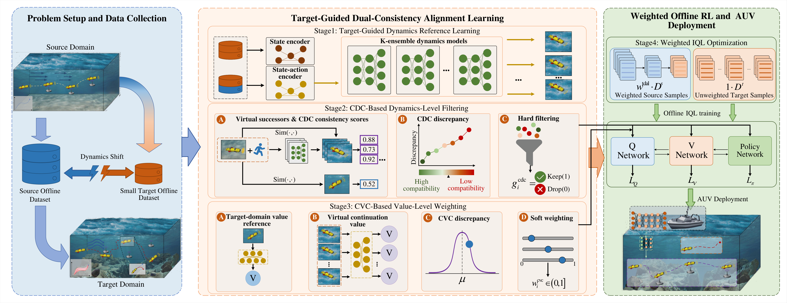

# TDAL-IQL

Target-Guided Dual-Consistency Alignment Learning for AUV path planning under dynamics shifts.



Experimental data are provided in [`data/`](data/).

## Installation

```bash
pip install -r requirements.txt
```

## Workflow

Run the commands below from the repository root.

### 1. Train an online SAC policy

Train a behavior policy in the source environment.

```bash
python -m trainers.online_sac --config configs/source_ads.json --steps 200000 --out runs/sac_source
```

### 2. Collect offline datasets

Freeze the policy and collect source and target data separately. Run the same collector with different policies or seeds as needed.

```bash
python -m offline.collect_data --config configs/source_ads.json --policy runs/sac_source/policy.pt --steps 100000 --out runs/data/source.npz
python -m offline.collect_data --config configs/target_ads_moderate.json --policy runs/sac_source/policy.pt --allow-dynamics-transfer --steps 1000 --out runs/data/target.npz
```

### 3. Train offline algorithms

Train TDAL-IQL using the collected datasets.

```bash
python -m trainers.offline_train --algorithm tdal --config configs/target_ads_moderate.json --source runs/data/source.npz --target runs/data/target.npz --updates 200000 --out runs/tdal
```

Change `--algorithm` to run `target_only_iql`, `source_only_iql`, `mixed_iql`, `vgdf_iql`, `vgdf_all_iql`, `cdc_q`, `darc_iql`, or `igdf_iql`. `vgdf_all_iql` filters source samples for Q, V, and policy updates; `cdc_q` uses Q-based weighting. Task configurations are in `configs/`; policy evaluation uses `trainers/evaluate.py`.
